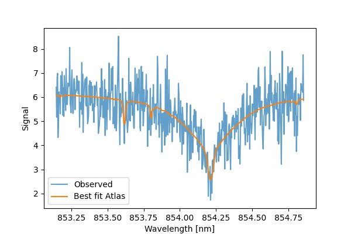

Accuracy Tests
==============

This page shows an example test designed to test the accuracy of the fitting model in the presence of increasing noise.
In this test we use the default `~solar_wavelength_calibration.atlas.atlas.Atlas` and "observe" it with the fit model
to produce a synthetic input spectrum. We then apply varying amounts of normally-distributed noise and run a fit; the
difference between the known "true" parameters and the resulting fit provides a rough estimate of how sensitive each
parameter is to noise.

Note that these tests do not vary many aspects that are important when considering real data (wavelength range, resolution, etc.),
and so this page can be considered an example of how to do your own accuracy assessments. Readers are encouraged to perform
their own tests that more closely align with their specific situation.

Test Code
---------

.. code-block:: python

    import numpy as np
    import matplotlib.pyplot as plt
    from solar_wavelength_calibration import Atlas, WavelengthCalibrationFitter, WavelengthCalibrationParameters
    from solar_wavelength_calibration import BoundsModel, FitFlagsModel, LengthBoundRange, DispersionBoundRange, AngleBoundRange, UnitlessBoundRange
    import astropy.units as u
    from astropy.units import Quantity
    from solar_wavelength_calibration.fitter.wavelength_fitter import WavelengthParameters
    from astropy.wcs import WCS
    from astropy.stats import gaussian_fwhm_to_sigma
    from scipy.ndimage import gaussian_filter1d

    def observe_atlas(*,
                      atlas: Atlas,
                      crval: Quantity,
                      dispersion: Quantity,
                      grating_constant: Quantity,
                      order: int,
                      incident_light_angle: Quantity,
                      resolving_power: float,
                      opacity_factor: float,
                      straylight_fraction: float,
                      continuum_level: float,
                      noise_fraction_sigma: float,
                      num_wave_pix: int,
                     ) -> tuple[np.ndarray, np.ndarray]:
        """Generate a fake 'observed' spectrum given a set of ground-truth parameters."""
        header = {
            "CTYPE1": "AWAV-GRA",
            "CUNIT1": "nm",
            "CRPIX1": num_wave_pix // 2 + 1,
            "CRVAL1": crval.to_value(u.nm),
            "CDELT1": dispersion.to_value(u.nm / u.pix),
            "PV1_0" : grating_constant.to_value(1 / u.m),
            "PV1_1" : order,
            "PV1_2" : incident_light_angle.to_value(u.deg)
        }
        wcs = WCS(header)
        wave_vec = wcs.spectral.pixel_to_world(np.arange(num_wave_pix)).to_value(u.nm)

        telluric_spec = np.interp(wave_vec,
                                  atlas.telluric_atlas_wavelength.to_value(u.nm),
                                  atlas.telluric_atlas_transmission)
        solar_spec = np.interp(wave_vec,
                               atlas.solar_atlas_wavelength.to_value(u.nm),
                               atlas.solar_atlas_transmission)
        combined_spec = solar_spec * (telluric_spec ** opacity_factor)

        sigma_nm = (crval / resolving_power) * gaussian_fwhm_to_sigma
        sigma_pix = (sigma_nm / np.abs(dispersion)).value

        degraded_spec = gaussian_filter1d(combined_spec, np.abs(sigma_pix))

        straylight_spec = (degraded_spec + straylight_fraction) / (1 + straylight_fraction)

        perfect_spec = straylight_spec * continuum_level

        rng = np.random.default_rng(seed=42)
        noise = rng.normal(loc=1, scale=noise_fraction_sigma, size=num_wave_pix)

        return wave_vec, perfect_spec * noise

    def display_results(true_values: dict, fit_result):
        names = ["crval",
                 "dispersion",
                 "incident_light_angle",
                 "resolving_power",
                 "opacity_factor",
                 "straylight_fraction",
                 "continuum_level"]
        units = [u.nm,
                 u.nm / u.pix,
                 u.deg,
                 "",
                 "",
                 "",
                 ""]

        valuesdict = fit_result.minimizer_result.params.valuesdict()
        print(f"{'Param':>20}{'abs diff':>20}{'unit':>10}{'rel diff (%)':>20}")
        print("-"*(20 + 20 + 10 + 20))
        for name, unit in zip(names, units):
            true_value = true_values[name]
            if unit:
                true_value = true_value.to_value(unit)
            absolute_diff = true_value - valuesdict[name]
            relative_diff = (absolute_diff / true_value) * 100
            print(f"{name:>20}{absolute_diff:20.5e}{unit:>10}{relative_diff:20.5f}")

    # Define the "ground-truth" parameters
    true_values = {
        "crval": 854.0 * u.nm,
        "dispersion": 0.00314159 * u.nm / u.pix,
        "grating_constant": 23 / u.mm,
        "order": 89,
        "incident_light_angle": 66 * u.deg,
        "resolving_power": 99_000,
        "opacity_factor": 1.5,
        "straylight_fraction": 0.5,
        "continuum_level": 6.28
    }
    num_wave_pix = 555

    # Apply perturbations to the true parameters to get incorrect "initial guess" parameters
    init_values = {
        "crval": true_values["crval"] + int(0.05 * num_wave_pix) * u.pix * true_values["dispersion"],
        "dispersion": true_values["dispersion"] * 1.02,
        "incident_light_angle": true_values["incident_light_angle"] - 1 * u.deg,
        "resolving_power": true_values["resolving_power"] * 0.98,
        "opacity_factor": true_values["opacity_factor"] * 0.9,
        "straylight_fraction": true_values["straylight_fraction"] * 1.3,
        "continuum_level": true_values["continuum_level"] * 0.8
    }

    def single_noise_test(noise_fraction_sigma: float):
        """Run a fit for a given noise fraction and display the results"""
        atlas = Atlas()
        _, spec = observe_atlas(atlas=atlas, noise_fraction_sigma=noise_fraction_sigma, num_wave_pix=num_wave_pix, **true_values)
        bounds = BoundsModel(crval=LengthBoundRange(min=init_values["crval"] * 0.98, max=init_values["crval"] * 1.02),
                         dispersion=DispersionBoundRange(min=init_values["dispersion"] * 0.6, max=init_values["dispersion"]*1.4),
                         incident_light_angle=AngleBoundRange(min=init_values["incident_light_angle"] - 1 * u.deg, max=init_values["incident_light_angle"] + 1* u.deg),
                         resolving_power = UnitlessBoundRange(min=5e4, max=5e5),
                         opacity_factor=UnitlessBoundRange(min=0.5, max=3),
                         straylight_fraction=UnitlessBoundRange(min=0.0, max=0.8),
                         continuum_level=UnitlessBoundRange(min=3, max=7))
        fit_flags = FitFlagsModel(crval=True,
                              dispersion=True,
                              incident_light_angle=True,
                              resolving_power=True,
                              opacity_factor=True,
                              straylight_fraction=True,
                              continuum_level=True)
        params = WavelengthCalibrationParameters(crval=init_values["crval"],
                                             dispersion=init_values["dispersion"],
                                             incident_light_angle=init_values["incident_light_angle"],
                                             grating_constant=true_values["grating_constant"],
                                             doppler_velocity=0 * u.km / u.s,
                                             order=true_values["order"],
                                             resolving_power=init_values["resolving_power"],
                                             opacity_factor=init_values["opacity_factor"],
                                             continuum_level=init_values["continuum_level"],
                                             bounds=bounds,
                                             fit_flags=fit_flags)
        fitter = WavelengthCalibrationFitter(input_parameters = params, atlas=atlas)
        fit_result = fitter(input_spectrum=spec, method="differential_evolution", tol=1e-10)

        print(f"{f' noise frac: {noise_fraction_sigma*100:.1f} % ':=^70}\n")
        display_results(true_values, fit_result)
        print("\n")

Results
-------

Here we show the absolute and relative difference between the true and fit parameter values for varying amounts of noise
from 0% - 15%.

.. code-block:: python

    >>> for n in [0, 0.01, 0.05, 0.1, 0.15]:
    ...   single_noise_test(n)

    ========================= noise frac: 0.0 % ==========================

                   Param            abs diff      unit        rel diff (%)
    ----------------------------------------------------------------------
                   crval         1.05000e-04        nm             0.00001
              dispersion        -5.41656e-07  nm / pix            -0.01724
    incident_light_angle         1.12009e-01       deg             0.16971
         resolving_power        -2.30186e+03                      -2.32511
          opacity_factor         1.42398e-01                       9.49322
     straylight_fraction         2.12968e-03                       0.42594
         continuum_level        -3.65266e-03                      -0.05816

    ========================= noise frac: 1.0 % ==========================

                   Param            abs diff      unit        rel diff (%)
    ----------------------------------------------------------------------
                   crval        -7.12101e-05        nm            -0.00001
              dispersion         3.48452e-07  nm / pix             0.01109
    incident_light_angle         1.47634e+00       deg             2.23688
         resolving_power         2.33623e+04                      23.59825
          opacity_factor        -1.65442e-01                     -11.02944
     straylight_fraction         1.74860e-03                       0.34972
         continuum_level        -1.96640e-03                      -0.03131

    ========================= noise frac: 5.0 % ==========================

                   Param            abs diff      unit        rel diff (%)
    ----------------------------------------------------------------------
                   crval        -9.85025e-04        nm            -0.00012
              dispersion         1.00944e-05  nm / pix             0.32132
    incident_light_angle         1.98495e+00       deg             3.00750
         resolving_power         3.92053e+04                      39.60127
          opacity_factor        -1.97538e-01                     -13.16917
     straylight_fraction        -9.42355e-03                      -1.88471
         continuum_level         7.88873e-03                       0.12562

    ========================= noise frac: 10.0 % =========================

                   Param            abs diff      unit        rel diff (%)
    ----------------------------------------------------------------------
                   crval         7.88399e-02        nm             0.00923
              dispersion        -1.15854e-03  nm / pix           -36.87749
    incident_light_angle         1.98231e+00       deg             3.00350
         resolving_power        -3.49887e+05                    -353.42108
          opacity_factor        -5.80959e-01                     -38.73063
     straylight_fraction         4.42253e-02                       8.84506
         continuum_level         2.07088e-01                       3.29757

    ========================= noise frac: 15.0 % =========================

                   Param            abs diff      unit        rel diff (%)
    ----------------------------------------------------------------------
                   crval        -2.15439e-03        nm            -0.00025
              dispersion         5.57081e-05  nm / pix             1.77325
    incident_light_angle         1.66009e+00       deg             2.51529
         resolving_power        -4.00593e+05                    -404.63931
          opacity_factor         9.96077e-01                      66.40512
     straylight_fraction        -3.67945e-02                      -7.35889
         continuum_level         2.96259e-02                       0.47175

Notice that the 0th and 1st order wavelength parameters (``crval`` and ``dispersion``) are well fit even with large amounts
of noise. On the other hand, the line-shape parameters (``resolving_power`` and ``opacity_factor``) suffer the most.

To get a visual sense of these numbers, here is the best-fit in the case of 15% noise:

.. code-block:: python

    >>> ax = plt.figure(figsize=(6,4)).add_subplot(111)
    >>> ax.set_xlabel("Wavelength [nm]")
    >>> ax.set_ylabel("Signal")
    >>> ax.plot(fit_result.best_fit_wavelength_vector, spec, alpha=0.7, label="Observed")
    >>> ax.plot(fit_result.best_fit_wavelength_vector, fit_result.best_fit_atlas, label="Best fit Atlas")
    >>> ax.legend(loc=0)
    >>> ax.figure.show()

    "Observe" Atlas fit with 15% normally distributed noise and imperfect initial guesses.